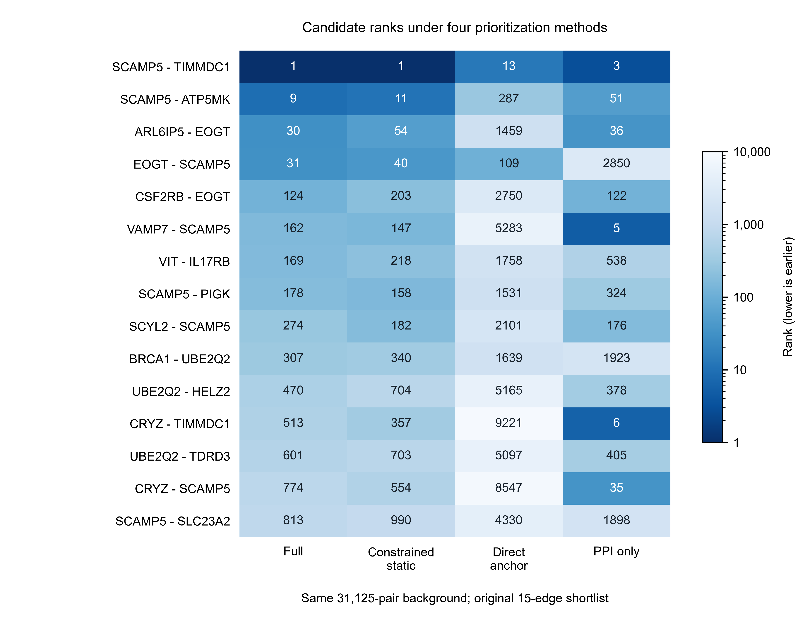

# Candidate-evidence example

## Question

How do the ranks of the original candidate shortlist vary across four prioritization methods, and which candidates remain selected after alternative evidence rules?

## Inputs

The four TSV files in `data/` are unchanged aggregate tables from the manuscript's archived candidate-evidence export. They contain protein identifiers, ranks, module membership and evidence summaries, not individual clinical records.

- `15_candidate_method_comparison.tsv`: all 15 original candidate pairs, method ranks and repeated-run shortlist frequency.
- `24_candidate_rule_review.tsv`: direction-aware and source-grouped selection indicators.
- `03_original_modules.tsv`: the three original modules and their 17 proteins.
- `14_nine_axis_data_dictionary.tsv`: the archived evidence-axis summary.

Checksums are recorded in `docs/source_manifest.json`. The example does not change the source data or recompute the original rankings.

## Run

```bash
python run.py example
```

Run from any directory by supplying the path to `run.py`. To choose an output directory:

```bash
python run.py example --output-dir outputs/my_candidate_example
```

## Reading the output

Each row is one original candidate edge. The four columns give its absolute rank in the same 31,125-pair universe. Numbers are the archived ranks; the color scale is logarithmic. A smaller rank means earlier prioritization. All 15 rows are retained in the archived order. These are individual recorded ranks, not replicate means, so there are no error bars or inferential tests in this display.

`candidate_summary.tsv` joins the ranks with selection-rule indicators. In particular, inclusion in the original shortlist does not imply inclusion after direction filtering. Evidence axes can share participants and should not be counted as independent replication cohorts. The module table describes the original shortlist, not a claim of new physical protein interactions.

This small example demonstrates result traceability and plotting. It is not an end-to-end training example; that workflow requires the resources in `docs/INPUTS.md`.

## Reference output

The `expected/` directory contains the verified example output for convenience. Running the example regenerates the figure and summary under `outputs/` without overwriting these reference files.


